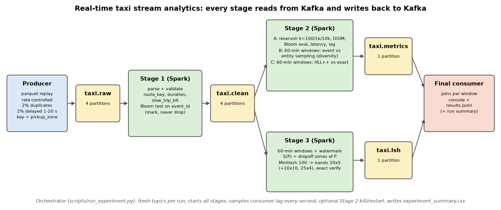

# Real-Time Taxi Stream Analytics - Kafka + Spark Structured Streaming + Sketches + LSH



Producer → `taxi.raw` → **Stage 1** (clean, enrich, Bloom) → `taxi.clean` → **Stage 2** (reservoir,
event/entity sampling, HLL, DGIM) → `taxi.metrics` and **Stage 3** (MinHash-LSH) → `taxi.lsh` →
**final consumer** → `results/results.jsonl`. Every stage after the producer reads from Kafka and
writes to Kafka; nothing reads the parquet file except the producer.

## Repository structure (as required by section 10 of the brief)

```
README.md  architecture.png  config.yaml  requirements.txt  LLM_USAGE.md  run_all.sh  run_all.bat
producer/
  producer.py              Taxi Data Producer: parquet -> taxi.raw
  pipeline_common.py       shared code: config loading, Kafka helpers (topics, lag), Spark/Kafka source helpers
  yellow_tripdata_2026-01.parquet   (data file, not in git - see 1.2)
stage1_clean_bloom/
  stage1.py                taxi.raw -> taxi.clean (validate, enrich, Bloom membership test)
  bloom.py                 Bloom filter (own implementation)
stage2_stream_analytics/
  stage2.py                taxi.clean -> taxi.metrics (reservoir, event/entity sampling, HLL++, DGIM, counters)
  dgim.py                  DGIM (own implementation)
  reservoir.py             reservoir sampling, Algorithm R
stage3_lsh/
  stage3.py                taxi.clean -> taxi.lsh (destination sets, MinHash-LSH, exact Jaccard baseline)
  minhash_lsh.py           MinHash signatures, banding, Jaccard
  show_lsh_window.py       prints candidate pairs + exact Jaccard of one window
  taxi_zone_lookup.csv     zone names
final_consumer/
  final_consumer.py        taxi.metrics + taxi.lsh -> console + results/results.jsonl
  run_experiment.py        orchestrator: fresh topics, start all stages + producer, lag monitor, summary row
  run_suite.py             all experiments of sections 7-8
  run_experiments.bat      wrapper for run_suite.py + analysis
  kafka_ctl.py             start / stop / reset the local Kafka broker, recreate topics
  analyze_results.py       results/analysis.md + results/plots/
  setup_windows.ps1        one-time setup on Windows
  docker-compose.yml       Kafka for Linux/macOS
results/
  results.jsonl            standardized output (all runs)
  experiment_summary.csv   one row per run
  analysis.md  plots/  runs/<run_id>/
```

---

## 1. Setup (once)

### 1.1 Requirements
* Windows 10/11 (reference machine) or Linux/macOS/WSL with Docker
* Java 17 (Temurin), Python 3.12, ~3 GB free disk, internet for the first Spark run (downloads the
  `spark-sql-kafka` package)

### 1.2 Data file
The producer replays `yellow_tripdata_2026-01.parquet` (NYC TLC yellow taxi trips, January 2026). It is
not in the repository (size, `.gitignore`). Download it from the
[NYC TLC trip record page](https://www.nyc.gov/site/tlc/about/tlc-trip-record-data.page) into `producer/`:

```powershell
Invoke-WebRequest https://d37ci6vzurychx.cloudfront.net/trip-data/yellow_tripdata_2026-01.parquet -OutFile producer\yellow_tripdata_2026-01.parquet
Test-Path .\producer\yellow_tripdata_2026-01.parquet      # True
```
The location is `data_file` in `config.yaml`.

### 1.3 Windows (native, no Docker/WSL/admin)
```powershell
powershell -ExecutionPolicy Bypass -File final_consumer\setup_windows.ps1
```
Installs, if missing: Java 17 (winget), Python 3.12, a venv at `%USERPROFILE%\.venvs\bda-a2` with
`requirements.txt`, Kafka 3.9.1 in `%USERPROFILE%\tools\kafka`, Hadoop `winutils.exe` + `hadoop.dll`
(+ `msvcr100.dll`) in `%USERPROFILE%\tools\hadoop`.

Shortcuts used in the rest of this README (set them in every new PowerShell window):
```powershell
$PY = "$env:USERPROFILE\.venvs\bda-a2\Scripts\python.exe"
$KB = "$env:USERPROFILE\tools\kafka\bin\windows"
```
(In `cmd.exe`: `set PY=%USERPROFILE%\.venvs\bda-a2\Scripts\python.exe` and use `%PY%`.)

### 1.4 Linux / macOS / WSL
```bash
python3.12 -m venv .venv && .venv/bin/pip install -r requirements.txt   # Java 17 must be on PATH
docker compose -f final_consumer/docker-compose.yml up -d               # Kafka 3.9.1 KRaft on 127.0.0.1:9092
PY=.venv/bin/python
```
On these systems always add `--set kafka_mode=external --set work_dir=/tmp/bda-a2` (done automatically
by `run_all.sh`); topics are then deleted/recreated instead of restarting the broker.

### 1.5 Sanity check
```powershell
java -version                                  # 17.x
& $PY final_consumer\kafka_ctl.py start        # Kafka started
& $PY final_consumer\kafka_ctl.py status       # running
```

---

## 2. Run the default pipeline (one command, ~3 min)

```powershell
.\run_all.bat                      # Windows
./run_all.sh                       # Linux / macOS / WSL
```
`run_all` = `final_consumer/kafka_ctl.py start` → `final_consumer/run_experiment.py --run-id default` →
`final_consumer/analyze_results.py`. The orchestrator:
1. resets the broker and creates fresh topics (`taxi.raw`/`taxi.clean`: 4 partitions,
   `taxi.metrics`/`taxi.lsh`: 1),
2. starts Stage 1, 2, 3 and the final consumer (staggered), waits until each is ready,
3. starts the producer (100 000 trips, 1 000 ev/s, 2 % duplicates, 2 % delayed 1-20 s),
4. samples consumer lag every second, waits for end-of-stream, stops all stages,
5. appends one row to `results/experiment_summary.csv` and regenerates `results/analysis.md`.

It ends with a line such as
`=== run default done ... produced=1018/s stage2=995/s p50/p95=2840/4346ms ... HLL=0.73% LSH recall=0.74`.

Follow a stage while it runs (second terminal):
```powershell
Get-Content results\runs\default\stage2.log -Wait
```

Any argument after `run_all.bat` is passed to `run_experiment.py`, so `--run-id` and `--set` work there.

---

## 3. Inspect the results

```powershell
Get-Content results\runs\default\results.jsonl -TotalCount 1     # one standardized window record
Get-Content results\runs\default\final_summary.json              # run summary
Import-Csv results\experiment_summary.csv | Format-Table run_id,produced_eps,stage2_eps,latency_p50_ms,latency_p95_ms,max_lag_raw,hll_mean_error_pct,lsh_recall_default
& $PY stage3_lsh\show_lsh_window.py --run default                # LSH candidates + exact Jaccard (busiest window)
& $PY stage3_lsh\show_lsh_window.py --run default --window 2026-01-05T08:00:00 --top 50
```

| Output | Content |
|---|---|
| `results/results.jsonl` | all runs: one record per event-time window + one `run_summary` per run |
| `results/runs/<run>/results.jsonl` | the same, for one run |
| `results/runs/<run>/final_summary.json` | run totals: Bloom, reservoir (all k), DGIM (all k), HLL mean/max error, LSH per setting, late events |
| `results/runs/<run>/stage1_stats.json` | accepted/rejected + reasons, Bloom confusion counts, false-positive examples |
| `results/runs/<run>/stage2_stats.json` | late-event classes + examples, restore info, watermark drops |
| `results/runs/<run>/lsh_windows.jsonl` | every LSH window with all candidate pairs and missed true pairs |
| `results/runs/<run>/producer_stats.json`, `producer_duplicates.csv`, `producer_delayed.csv` | actual rate, ground truth for duplicates and delays |
| `results/runs/<run>/lag_timeline.csv`, `stage1_batches.csv`, `stage2_batches.csv` | lag per second, per-batch throughput |
| `results/runs/<run>/partition_counts.json` | messages per partition (skew) |
| `results/runs/<run>/*.log` | console output of every process |
| `results/experiment_summary.csv` | one row per run (the experiment table) |
| `results/analysis.md`, `results/plots/*.png` | generated tables and figures |

Every window record contains the mandatory fields of section 9 of the brief (`run_id`, `window_start`,
`window_end`, `events_processed`, `producer_eps`, `stage2_eps`, `consumer_lag`, `latency_p50_ms`,
`latency_p95_ms`, `bloom`, `sampling`, `hll`, `dgim`, `lsh`) plus `diversity`, `late_events` and details.

### Look inside Kafka
After a run the broker keeps running, so the topics can still be read:
```powershell
& "$KB\kafka-topics.bat" --bootstrap-server 127.0.0.1:9092 --list
& "$KB\kafka-topics.bat" --bootstrap-server 127.0.0.1:9092 --describe
& "$KB\kafka-console-consumer.bat" --bootstrap-server 127.0.0.1:9092 --topic taxi.raw --from-beginning --max-messages 5 --property print.key=true --property print.partition=true
& "$KB\kafka-console-consumer.bat" --bootstrap-server 127.0.0.1:9092 --topic taxi.clean --from-beginning --max-messages 5
& "$KB\kafka-console-consumer.bat" --bootstrap-server 127.0.0.1:9092 --topic taxi.metrics --from-beginning --max-messages 3
& "$KB\kafka-console-consumer.bat" --bootstrap-server 127.0.0.1:9092 --topic taxi.lsh --from-beginning --max-messages 1
& "$KB\kafka-consumer-groups.bat" --bootstrap-server 127.0.0.1:9092 --describe --group stage1   # offsets/lag on taxi.raw
& "$KB\kafka-consumer-groups.bat" --bootstrap-server 127.0.0.1:9092 --describe --group stage2   # offsets/lag on taxi.clean
```
The first ~3 000 messages of `taxi.raw`/`taxi.clean` are `WARMUP` control records (ignored by all
metrics); real trips follow. On Linux/Docker use
`docker exec -it bda-kafka /opt/kafka/bin/kafka-console-consumer.sh ...` with the same arguments.

---

## 4. Change parameters

All parameters live in [`config.yaml`](config.yaml) (the brief's parameter names are used unchanged).
Either edit the file, or override per run without touching it:
```powershell
.\run_all.bat --run-id <name> --set key=value --set key2=value2
& $PY final_consumer\run_experiment.py --run-id <name> --set key=value [--restart-stage2 AFTER_S:DOWN_S] [--notes "text"]
```
Each run writes `results/runs/<name>/` and adds/replaces its row in `results/experiment_summary.csv`.

| Key | Default | Meaning |
|---|---|---|
| `partitions` | 4 | partitions of `taxi.raw` and `taxi.clean` |
| `parallelism` | 4 | Spark task slots per stage (`local[N]`) = parallel consumers |
| `partition_key` | `pickup_zone` | `pickup_zone` or `none` (no key, sticky round-robin) |
| `producer_rate` | 1000 | requested events/second |
| `duplicate_rate` / `delayed_event_rate` / `max_delay_seconds` | 0.02 / 0.02 / 20 | injected duplicates and delays |
| `window_minutes` / `watermark_minutes` | 60 / 30 | event-time window and allowed lateness |
| `bloom_expected_items` / `bloom_false_positive_target` | 200000 / 0.01 | Bloom sizing |
| `reservoir_sizes` / `reservoir_report_k` | [100,1000,10000] / 1000 | reservoirs kept / k in the standard `sampling` field |
| `sampling_rate`, `diversity_min_destinations` | 0.10, 10 | event-sampling rate, "diverse" threshold |
| `hll_precision` | 12 | HLL++ precision p (2^p registers) |
| `dgim_max_window` / `dgim_queries` / `dgim_report_k` | 10000 / [1000,5000,10000] / 5000 | DGIM window, queried k, k in the standard `dgim` field |
| `lsh_num_hashes` / `lsh_bands` / `lsh_rows_per_band` | 100 / 20 / 5 | default MinHash-LSH setting (bands × rows must equal hashes) |
| `lsh_extra_settings` | [[10,10],[25,4]] | extra (bands, rows) settings evaluated on the same windows |
| `jaccard_threshold`, `lsh_min_trips` | 0.50, 20 | "truly similar" threshold, minimum trips per zone |
| `max_events`, `segment_start` | 100000, 2026-01-05T00:00:00 | replayed segment (identical in every run) |
| `slow_trip_minutes`, `max_trip_minutes`, `max_trip_miles`, `max_fare` | 30, 300, 100, 1000 | Stage 1 enrichment/validation |
| `report_interval_seconds` | 5 | periodic summary interval of Stage 2 |
| `data_file` | `producer/yellow_tripdata_2026-01.parquet` | source file of the producer |
| `kafka_mode` | `native` | `native` (bundled broker, Windows) or `external` (Docker/existing broker) |

List values are given in YAML syntax: `--set "lsh_extra_settings=[[50,2],[25,4]]"`.

---

## 5. TA demonstration commands (brief section 11)

| # | Check | Command | Where to look |
|---|---|---|---|
| 1 | Records flow raw → clean → outputs | `.\run_all.bat` | console, topic commands in §3, `results/runs/default/results.jsonl` |
| 2 | Change producer rate | `.\run_all.bat --run-id rate-test --set producer_rate=15000` | `lag_timeline.csv`, `max_lag_raw`, `stage2_eps`, p95 in `experiment_summary.csv` |
| 3 | Change partitions / consumers | `.\run_all.bat --run-id p1-demo --set partitions=1 --set parallelism=1` | `skew_raw`, throughput; `kafka-topics --describe` |
| 4 | Bloom / HLL / DGIM exact vs approx | (any run) | `bloom`, `hll`, `dgim` fields; `final_summary.json` |
| 5 | Change DGIM k / reservoir size | `.\run_all.bat --run-id k-test --set dgim_report_k=1000 --set reservoir_report_k=10000` | `dgim.k`, `sampling.k` in `results.jsonl` |
| 6 | LSH candidates + exact Jaccard | `& $PY stage3_lsh\show_lsh_window.py --run default` | console |
| 7 | 6 consumers vs 4 partitions | compare P3 and P4 rows | `experiment_summary.csv`, `results/analysis.md` §7.2 |
| 8 | Small change | e.g. `--set "lsh_extra_settings=[[50,2]]"` or `--set slow_trip_minutes=20` | new run folder |

Other useful variants:
```powershell
.\run_all.bat --run-id key-test --set partition_key=none                     # K2-style, no message key
.\run_all.bat --run-id bloom-test --set bloom_expected_items=2000            # forces Bloom false positives
.\run_all.bat --run-id quick --set max_events=20000                          # short smoke run (~1.5 min)
& $PY final_consumer\run_experiment.py --run-id restart-test --set producer_rate=1000 --restart-stage2 40:20   # kill Stage 2 40 s in, down 20 s
```

---

## 6. Run all experiments (sections 7-8, ~40 min)

```powershell
.\final_consumer\run_experiments.bat                     # default, P1-P4, K1, K2, R-low/medium/high, restart, bloom-small
.\final_consumer\run_experiments.bat --only P1,P3,K2     # subset
& $PY final_consumer\run_suite.py --only R-high          # same without the wrapper
& $PY final_consumer\analyze_results.py                  # rebuild results/analysis.md + results/plots/ from results/runs/*
```

| Run | Overrides |
|---|---|
| `default` | config.yaml as is (4 partitions, 4 slots, key = pickup_zone, 1 000 ev/s) |
| `P1` / `P2` / `P3` / `P4` | partitions/parallelism 1/1, 4/1, 4/4, 4/6 at 6 000 ev/s |
| `K1` / `K2` | 4/4 at 6 000 ev/s, key `pickup_zone` / `none` |
| `R-low` / `R-medium` / `R-high` | 4/4 at 1 000 / 6 000 / 15 000 ev/s |
| `restart` | 1 000 ev/s, Stage 2 killed 40 s into the run for 20 s |
| `bloom-small` | `bloom_expected_items=2000`, 3 000 ev/s (false-positive demonstration) |

---

## 7. Run the stages by hand (live demo)

Each process in its own terminal (set `$PY` in each). Output goes to `results/runs/<run_id from config.yaml>/`.
```powershell
& $PY final_consumer\kafka_ctl.py start          # 1. broker
& $PY final_consumer\kafka_ctl.py topics         # 2. fresh topics (native mode: wipes and restarts the broker)
& $PY -m stage1_clean_bloom.stage1               # 3. terminal A
& $PY -m stage2_stream_analytics.stage2          # 4. terminal B
& $PY -m stage3_lsh.stage3                       # 5. terminal C
& $PY -m final_consumer.final_consumer           # 6. terminal D
& $PY -m producer.producer                       # 7. terminal E - after stages 3-6 print "running"/"consuming"
```
To use different parameters here, edit `config.yaml` (or point `BDA_CONFIG` at a JSON/YAML copy:
`$env:BDA_CONFIG="my_config.yaml"` in every terminal). Delete the old Spark checkpoints first when you
reuse a `run_id`: `Remove-Item -Recurse "$env:LOCALAPPDATA\bda-a2\checkpoints\default","$env:LOCALAPPDATA\bda-a2\state\default"`.

**Manual restart test:** while the producer runs, press Ctrl+C in terminal B, watch
`kafka-consumer-groups.bat --describe --group stage2` (LAG grows), wait ~20 s, start Stage 2 again. It
prints `restored state after batch N`; lag drains and `events_processed` ends at the same total
(99 738) as an uninterrupted run.

---

## 8. Kafka control

```powershell
& $PY final_consumer\kafka_ctl.py start      # start broker (formats storage on first use; wipes + retries if it crashes)
& $PY final_consumer\kafka_ctl.py status     # running / not reachable
& $PY final_consumer\kafka_ctl.py topics     # fresh topics with the configured partition counts
& $PY final_consumer\kafka_ctl.py stop       # stop broker
& $PY final_consumer\kafka_ctl.py reset      # stop, wipe all broker data, start fresh
docker compose -f final_consumer/docker-compose.yml up -d     # Linux/macOS broker (down to stop)
```
Kafka data, Spark checkpoints and Stage 2 state snapshots live in `work_dir`
(`%LOCALAPPDATA%\bda-a2` on Windows), outside OneDrive.

### Troubleshooting
| Symptom | Fix |
|---|---|
| `Python environment not found` | run `final_consumer\setup_windows.ps1` |
| `FileNotFoundError ... parquet` | download the data file into `producer\` (§1.2) |
| `Kafka broker not reachable` / broker crashed | `& $PY final_consumer\kafka_ctl.py reset`; log: `%LOCALAPPDATA%\bda-a2\kafka.log` |
| `stageN not ready ... relaunching` | expected occasionally (Spark local-mode start-up race); relaunched automatically |
| `stageN died` | read `results\runs\<run>\stageN.log` |
| first run slow | Spark downloads `spark-sql-kafka` once (needs internet) |
| leftover processes after Ctrl+C | `Get-Process java,python \| Stop-Process -Force`, then `kafka_ctl.py start` |

---

## 9. Technology and why

* **Kafka 3.9.1 (KRaft, single node)** running natively on Windows - Docker/WSL were not installed and
  need admin + reboot. Native topic deletion crashes the broker on Windows, so a clean run wipes and
  restarts the broker (≈5 s) - the brief allows "another clean equivalent".
  `final_consumer/docker-compose.yml` is provided for other machines.
* **Spark Structured Streaming 3.5.3 (PySpark, `local[N]`)** for Stages 1-3: native Kafka source,
  event-time windows with watermarks, checkpointed offsets and state, built-in HyperLogLog++
  (`approx_count_distinct`). `local[N]` = N processing slots (the "consumers" of section 7).
* **Driver-side sketches in `foreachBatch`** for the order-dependent single-stream structures (Bloom
  filter, reservoir, DGIM): one global instance gives one consistent answer for the whole stream and
  every parameter can be reported. DGIM, Bloom, reservoir and MinHash/banding are our own code
  (`stage1_clean_bloom/bloom.py`, `stage2_stream_analytics/dgim.py`, `reservoir.py`,
  `stage3_lsh/minhash_lsh.py`).
* **confluent-kafka** for the producer, the final consumer and offset/lag observation.

## 10. Machine

AMD Ryzen 7 7840HS (8 cores / 16 threads), 15.3 GB RAM, Windows 11 Home 10.0.26300, local SSD.
No Docker, no WSL, no cloud. Java 17 (Temurin), Python 3.12.10. All stages, the broker and the
producer share this machine.

## 11. Design notes

* **Event schema** - as in section 2.2 of the brief plus `dropoff_time` (needed for
  `trip_duration_min`). `event_id = 2026-01-row-<original parquet row>` is stable; a duplicate resend
  carries the same id. Segment: the first 100 000 trips with pickup ≥ 2026-01-05 00:00 (≈27 event-time
  hours), identical in every run.
* **Stage 1** rejects missing/invalid zones, unparsable timestamps, duration ≤ 0 or > 300 min,
  negative or > $1000 fares, negative or > 100 mile distances (the source contains 269 097-mile trips).
  The Bloom filter (m = 1 917 012 bits, k = 7 for 200 000 items at 1 %) only *marks*
  `bloom_seen_before`; an exact id set provides `gt_seen_before` for evaluation.
* **Windows / watermark** - 60-minute tumbling event-time windows, watermark = max event time − 30 min,
  append mode: a window is emitted once, when the watermark passes its end; later rows for it are
  dropped. A replay of 1 000 ev/s covers ≈5 700 trips per event-time hour, so a 1-20 s wall-clock delay
  is 10 min - 3.5 h of event time: many deliberately delayed events arrive after their window closed.
* **End of stream** - the producer writes an `EOS` control record with a far-future event time to every
  partition; Stage 1 forwards it once all raw partitions delivered it. It advances the watermarks so the
  last windows close. A short `WARMUP` phase (control records, ignored by all metrics) lets Spark compile
  its queries before measurement.
* **Latency** = Stage 2 processing time − `producer_ts_ms` per event (p50/p95 over the run).
  **Throughput** per stage = events / time to process the first 95 % of them (excludes the delayed
  tail). **Lag** = committed offsets of `stage1`/`stage2` vs log-end offsets, sampled every second
  (Spark keeps its own offsets in the checkpoint; the stages also commit them to Kafka for observability).

## 12. Experiments and main observations

Full tables and plots: `results/analysis.md`, `results/plots/`, `results/experiment_summary.csv`.
Same 100 000-trip segment in every run, fresh topics per run.

* **Default run** (4 partitions, 4 slots, key = pickup_zone, 1 000 ev/s): 1 018 ev/s produced,
  995 ev/s through Stage 2, p50/p95 latency 2.8 / 4.3 s, 28 windows. Bloom (m = 1.9 M bits, k = 7):
  all 2 017 real repeats flagged, 3 false positives (FP rate 3.1e-5), 0 false negatives. HLL++ (p = 12,
  3.3 KB) mean error 0.73 %, max 1.7 %. DGIM error 11-24 % for k = 1 000 / 5 000 / 10 000 with 14 buckets.
* **Bloom FP demo** (`bloom-small`, filter sized for 2 000 items): 90 538 false positives - dropping
  flagged events would delete most genuine trips, which is why Stage 1 only marks them.
* **Reservoir sampling** (linear statistic): fare error over seven runs 0.5-13 % (k = 100), 0.3-2.4 %
  (k = 1 000), 0.3-1.4 % (k = 10 000) - shrinks roughly like 1/sqrt(k).
* **Event vs entity sampling** (fraction of zones with >= 10 destinations): event sampling is biased low
  (mean abs. error 0.140) because a zone's property needs its complete trips; entity sampling with the same
  storage is unbiased (0.060).
* **LSH**: 20x5 recall 0.74 with 87 % fewer comparisons; 25x4 recall 0.95 with twice the candidates;
  10x10 recall 0.03 (S-curve thresholds 0.55 / 0.45 / 0.79). At ~50 zones per window exact all-pairs is just
  as fast (~2-5 ms).
* **P1-P4** (6 000 ev/s): Stage 2 5 055 / 5 257 / 5 324 / 4 842 ev/s - no material gain from partitions or
  slots, because half of each micro-batch is serial driver work (global Bloom/DGIM/reservoir, publishing) plus
  Spark's fixed per-batch cost. P4: with 4 partitions only 4 tasks exist, 2 of 6 slots stay idle.
* **K1 vs K2**: busiest partition 0.300 (pickup_zone) vs 0.270 (no key); throughput difference within
  run-to-run noise. Spark shuffles for per-zone state either way; the key buys per-zone ordering, not locality.
* **Rates** low / medium / high = 1 000 / 6 000 / 15 000 ev/s: processed 993 / 5 389 / 7 803 ev/s, p95
  4.1 / 6.2 / 9.3 s, max raw lag 3 k / 24 k / 85 k. HLL error and LSH recall unchanged - speed changes
  *when* answers arrive, not the answers; only watermark drops grow (1 417 / 1 790 / 1 793).
* **Late events** (watermark 30 min, append mode): of 1 988 deliberately delayed events, 1 429 arrived after
  their window closed and were discarded, 559 were still included.
* **Restart**: Stage 2 hard-killed for 36 s; taxi.clean lag rose to 46 621 and drained within seconds after
  restart; offsets came from the Spark checkpoint, sketch state from our snapshot (`restored state after
  batch 15`), and 99 738 events were counted - identical to the uninterrupted run (no double counting).

## 13. Known limitations

* Laptop scale: at 6 000 / 15 000 ev/s the 100 000-event segment lasts only 17 / 7 s, so those runs are a
  burst plus drain; all processes share one machine (run-to-run noise ~5-10 %).
* Bloom, reservoir and DGIM run on the Spark driver (one global, order-dependent structure) - simple and exactly
  reportable but not horizontally scalable.
* Spark micro-batches cost ~1 s each on Windows (checkpoint writes via winutils): this sets a latency floor.
* Spark local mode occasionally fails to start (block-manager registration race); `run_experiment.py`
  relaunches the stuck stage automatically.
* Results are emitted once per window (append mode); events beyond the watermark are discarded, not merged.
* The data file is not part of the submission (size); see §1.2.
